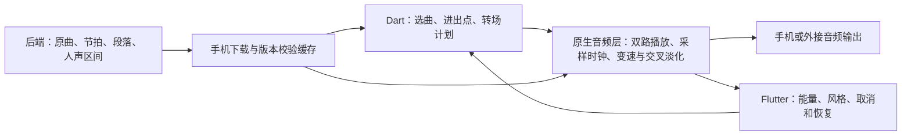

# 手机混音接入评估

> 后续实现与真机记录见 [2026-09-20 更新](live-mixing-ble-20260920.md)。本文原始结论保留为当时截点。

2026-09-16，依据下载目录中的 `harbeat_mixing_algorithm_vocal_v4_20260913_packaged.zip`，以及当前 Flutter 前端和后端分支 `archive/music-analysis-history-20260830`（ae1e492）。压缩包已解压到工作区 `harbeat-mixing-reference`，原压缩包未改动。

**结论：Android 和 iOS 都可运行这套决策算法，规则层迁移较方便；把当前离线渲染脚本变成可实时控制的手机播放器，需要单独实现音频执行层。无需把 Jetson 的分析模型搬进手机。**

## 这份包实际包含什么

| 部分 | 代码依据 | 手机迁移判断 |
|---|---|---|
| 核心规则 | harbeat/tempo.py、key_compatibility.py、drums.py、cue_points.py、scoring.py、transition.py | 纯 Python 数值、集合和条件判断，可翻译为 Dart，Android/iOS 共用 |
| 六首小集合规划 | harbeat/planner.py 的 MiniSetPlanner | 贪心选曲，可迁为 Dart；这是通用规则，并非当前 v4 人声感知完整流程 |
| v4 人声避让与顺序 | scripts/render_edm_bundle_smooth_v3.py 中 vocal_ratio、choose_entry_cue、choose_exit_cue、_vocal_pair_score、order_tracks | 仍以结构化数据计算，适合拆成独立 Dart 规划模块；必须连同这些函数迁移，不能只搬 MiniSetPlanner |
| NAS/bundle 读取 | harbeat/preprocess_reader.py | 依赖本地目录、索引、manifest、_SUCCESS、文件 SHA256；手机改为后端 API 与 App 私有缓存，不照搬 NAS 路径 |
| 离线音频生成 | render_segment、render_crossfaded_mix、render_snippets | 使用 subprocess 调用 ffmpeg/ffprobe；不能直接当作 Android/iOS 实时音频接口 |

`pyproject.toml` 的 dependencies 为空。它与旧仓库中依赖 NumPy/sounddevice 的 RK audio-runtime 是两套实现，不能用旧引擎的依赖判断这个压缩包是否能上手机。

当前 v4 使用 master 原曲长 crossfade（通常 12–18 秒），进入段用 atempo，之后拼接未变速段。`stem_blend` 等计划名称不代表已做相应 stem 音频混合；当前渲染实际以 master 为主。16-bar restore 仍是计划信息，没有变成完整连续的变速自动化。脚本会探测 Rubber Band，但实际 render_segment 使用的是 atempo，不能因为输出记录 rubberband_available 就判断已经调用它渲染。

## 推荐实现分工

| 平台 | 规则层 | 实时音频层 | 实际难点 |
|---|---|---|---|
| Android | Dart 共用 | Oboe/AAudio 输出，可接共享 C/C++ DSP | 机型差异、音频路由、后台、中断和缓冲稳定性，需要真机测量 |
| iOS | 同一份 Dart | AVAudioEngine/Audio Unit，也可接共享 C/C++ DSP | 音频会话、后台、中断与采样率转换；需要 Mac/Xcode 编译签名和真机验证 |

Flutter 支持通过 FFI 绑定原生代码，适合复用 DSP；控制参数通过平台桥接或 FFI 下发即可。不要每个采样块穿过 UI 线程，不在音频回调中下载文件、搜索歌曲或分配大量对象。[Flutter FFI](https://docs.flutter.dev/platform-integration/bind-native-code)、[Android 低延迟音频](https://developer.android.com/games/sdk/oboe/low-latency-audio)、[Apple AVAudioEngine](https://developer.apple.com/documentation/avfaudio/avaudioengine)。

当前 just_audio 是普通单路播放能力的实现，尚无双路共享时钟和转场执行层。两个普通播放器配合 Dart Timer 可做粗略演示，但不能据此承诺准确卡拍、无缝变速和现场稳定性。

## 后端还需要给手机的字段

| 算法所需 | 当前来源/缺口 |
|---|---|
| track_id、analysis_run_id、manifest_sha256 | 第二版详情合同提供；前端已经保留版本信息 |
| BPM、Camelot/key、节拍/小节、段落、transition_windows、drum_groups.pattern_16 | 第二版完整 analysis 对象可提供；前端已经保留，规划器要做显式字段适配 |
| 人声 intervals 的 start_ms/end_ms | 第二版详情只写了 vocal_summary；摘要不足以避开人声，需要服务端提供完整人声区间或受控报告读取接口 |
| 人声报告与曲目版本的绑定 | 必须带 analysis_run_id、manifest/vocals 指纹，防止把旧报告用在新音轨 |
| master 下载地址、时长、SHA256、采样率和通道 | 普通播放现在已适配 stream/preview；实时混音还需要可缓存、可校验的音频资产描述 |
| stem 音频 | v4 master crossfade 首版不强制下载所有分轨；确实实现 stem 混合后再按需获取 |

算法内部部分单位是秒，NAS 合同是毫秒，原生音频执行层最终使用采样帧。必须集中做单位转换，并处理播放速度改变后的源时间与输出时间映射。

不能直接拿 v4 beam search 对整个 157 首库不断重新排序：它面向小集合，beam 宽度 80，并在搜索中重复算候选对。先过滤到小候选池，再按冻结版本缓存成对评分；计算放到后台 isolate，避免拖慢手势和播放 UI。

## 本轮验证及边界

- 原包 Python 测试最初 28/29 通过；唯一失败是测试写死 POSIX `/` 路径分隔符。只在解压副本将 `str(path)` 改为 `path.as_posix()` 后，29/29 通过，未改算法行为。
- 桌面 Python 合成 metadata 微基准：8 个候选选六首，100 次中位数 0.178 ms；157 个候选选六首，中位数 3.514 ms。测试的是通用贪心 MiniSetPlanner，不是 v4 beam search、音频渲染或手机性能，不能据此承诺手机延迟。
- 压缩包约 111 KB，不含本次完整八首真实音频。未重新生成完整串烧，未试听验证当前素材的混音质量。
- 更新于 2026-09-18：生产入口已确认为阿里云 `https://8.136.120.255`，专用测试账号已完成真实注册/登录。已补上传、会话保持与身份显示；线上上传的数据库错误仍待部署后端修复包，分析及原曲云端播放的正向全流程尚未验收。
- Android 构建下载问题已解决，新 APK 已安装真机；52 个 Flutter 测试、静态分析和 Web 构建通过。这些结果不代表混音引擎已移植；iOS 未在 Mac/Xcode 验证。

## 建议落地顺序

1. 用实际后端地址完成当前曲库和两首不同原曲联调，确认 analysis 和人声区间完整性。
2. 迁移 v4 规划函数到 Dart，用 Python 输出建立固定输入/输出对照，先保持同样选曲、进出点和 overlap 结果。
3. 实现两首 master 的预加载、共享时钟、crossfade 与取消；手机操作由执行回执更新，不以定时器推测成功。
4. 加入保调变速与连续 16 小节恢复，测听感、掉帧、发热、后台和蓝牙路由变化。
5. 最后增加 stem 分层和复杂手势控制。

若当前目标只是手机播放自动串烧，可以先由服务端运行既有离线渲染，手机播放结果文件；若要手机根据能量/风格实时改变后续转场，采用上述手机规划加原生执行层的路线。
